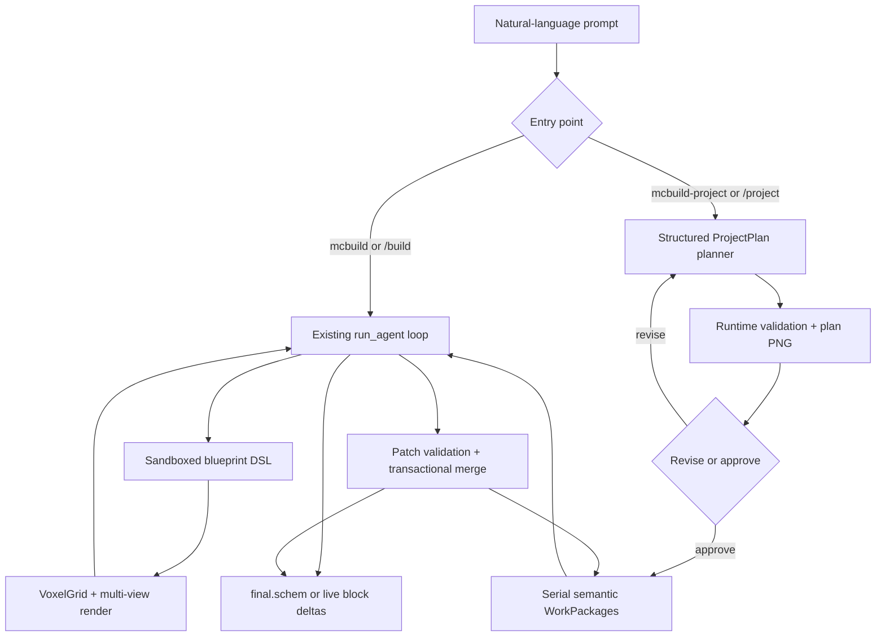

# mcbuild Multi-Agent

## YAN: project context and completed audit

- [Project concept and long-term goal](docs/YAN_PROJECT_CONCEPT.md)
- [Completed Mekanism audit: results, evidence and original archives](docs/recon/MEKANISM_AUDIT.md)
- [Reusable external tools and integration priorities](docs/REUSE_CATALOG.md)
- [Structured model defaults](docs/recon/mekanism/oracle_defaults.json)
- [Agent context-recovery rules](AGENTS.md)

The audit already exists. Read these sources before proposing another broad recon.


**Turn a text prompt into a Minecraft build — as one self-editing building agent, or as a coordinated multi-component project.**


[](LICENSE)

This fork keeps the original single-building workflow and adds the first complete milestone of a large-project orchestrator. A project planner can split a town, castle complex, or harbor district into semantic work packages, review a rendered site plan, run the existing building agent once per package, enforce spatial permissions at the voxel layer, and merge the results into one `.schem` file.


*Unedited output from the original single-building agent; it is not a multi-agent project render.*

## What is implemented

| Workflow | Entry point | Best for | Execution model |
| --- | --- | --- | --- |
| Single build | `mcbuild "..."` | One building or tightly coupled structure | One existing self-editing agent |
| Large project | `mcbuild-project "..."` | Towns, compounds, districts, repeated building families | Planner + serial semantic workers |
| Live single build | Minecraft `/build <prompt>` | Streaming one build into a world | Existing WebSocket protocol |
| Live large project | Minecraft `/project <prompt>` | Streaming merged project components | Same protocol and block placement code |

The project workflow is deliberately conservative in this milestone:

- the planner must return a structured, runtime-validated `ProjectPlan`;
- the planner sees a deterministic top-down plan image and must revise or explicitly approve it;
- repeated elements stay in one `WorkPackage` with multiple `Instance` anchors;
- real-LLM execution schedules at most one existing `run_agent(...)` call per work package and never one call per `Instance`; offline mode injects a deterministic runner;
- workers execute serially in stable dependency order;
- hard, soft, and interface permissions are enforced against the returned `VoxelGrid`;
- every accepted patch is merged transactionally and saved with a report;
- the CLI can run the entire project pipeline offline with deterministic fake planner and worker fixtures.

## Architecture



The orchestrator wraps the existing agent rather than copying or forking its loop. Project-only context is appended through an optional keyword argument; ordinary `mcbuild` and `/build` calls retain the original system prompt and behavior.

## Requirements

- Python 3.11+
- [`uv`](https://docs.astral.sh/uv/)
- An API key for OpenRouter, Poe, OpenAI, or an explicitly configured compatible endpoint
- Minecraft 1.21.1 + NeoForge 21.1 for live building
- JDK 21 recommended for building the mod

## Installation

```bash
git clone https://github.com/plaeyr123/mcbuild_multiagent_fork.git
cd mcbuild_multiagent_fork
uv sync --extra dev
```

For real LLM runs, create `.env` from `.env.example`. OpenRouter remains the default:

```dotenv
OPENROUTER_API_KEY=your_key_here
```

Provider selection is explicit and never inferred from the model id. Set `MCBUILD_LLM_PROVIDER`
to `poe`, `openai`, `openrouter`, or `openai_compatible`, then set the matching key variable.
Compatible endpoints additionally require `MCBUILD_LLM_BASE_URL`; their Planner defaults to
the existing function-tool fallback, while an explicitly supported capability can be selected
with `MCBUILD_PLAN_JSON_MODE=responses`, `chat_response_format`, or `tool_call`. Planner plan
generation uses Responses JSON Schema for Poe and direct OpenAI, and Chat JSON Schema for
OpenRouter. Builder and single-building calls continue to use Chat tool calling.

Offline fake modes do not need an API key or network access.

## Single-building CLI

```bash
uv run mcbuild "a medieval watchtower with interior spiral stairs"
```

The agent writes a sandboxed Python blueprint, renders the resulting voxels, inspects its own images and textual queries, edits the accumulated source, and exports the best completed result.

Useful options include:

```text
--model
--max-iters
--seed
--display auto|sixel|ansi|off
--reference / --no-reference
--reasoning off|low|medium|high
--stream / --no-stream
--cost-ceiling
--session-id
```

See the exact installed options with:

```bash
uv run mcbuild --help
```

### Offline single-building demo

The scripted test/demo mode exercises the real agent loop without contacting an LLM:

```bash
uv run mcbuild "a tiny stone hut" --fake-llm --display off
```

A normal single-build run writes artifacts below `runs/<timestamp>-<slug>/`, including blueprint source, renders, stats, per-iteration schematics, the full session, `final_blueprint.py`, and `final.schem` when a build succeeds.

## Large-project CLI

Use the project entry point when the request contains several semantic structures or repeated building families:

```bash
uv run mcbuild-project "build a fortified medieval river town"
```

The planner model must support tool calls and image input. The worker model must support the existing vision-based mcbuild loop.

Key options:

```text
--model                 worker model
--planner-model         planning and visual-review model
--max-iters             edit budget per worker
--planner-max-iters     submitted plan-version limit
--max-components        semantic work-package limit
--seed
--display
--out
--reasoning
--cost-ceiling          global planner + all-workers USD ceiling
--fake-llm              deterministic offline end-to-end mode
```

See all defaults with:

```bash
uv run mcbuild-project --help
```

### Offline project demo

```bash
uv run mcbuild-project "a small fortified settlement" --fake-llm --display off
```

This still executes the real orchestration path:

1. structured plan submission;
2. plan validation;
3. deterministic Pillow plan rendering;
4. planner approval;
5. stable dependency ordering;
6. one worker call per executed semantic package;
7. responsibility-mask validation;
8. transactional merge;
9. final schematic export.

## Project contracts

### ProjectPlan and semantic work packages

`ProjectPlan` contains the site, shared `StyleBible`, work packages, dependencies, instances, responsibilities, and explicit interface zones. External LLM JSON is decoded through strict `from_dict` methods and then semantically validated; tool schemas are never treated as sufficient validation.

A repeated family remains one package:

```json
{
  "id": "castle_tower_family",
  "instances": [
    {"id": "north_west", "anchor": [-30, 0, -24], "rotation": 0},
    {"id": "north_east", "anchor": [30, 0, -24], "rotation": 90},
    {"id": "south_west", "anchor": [-30, 0, 24], "rotation": 270},
    {"id": "south_east", "anchor": [30, 0, 24], "rotation": 180}
  ]
}
```

These four instances are assigned to one worker invocation, and the prompt instructs that worker to reuse shared construction logic, dimensions, materials, and style across every anchor.

### RegionExpr and 2.5D responsibility

Responsibilities combine an inclusive `min_y..max_y` range with a two-dimensional `RegionExpr`. Supported primitives are:

- axis-aligned rectangles;
- rotated rectangles;
- circles;
- ellipses;
- polygons with deterministic boundary inclusion.

Expressions support recursive `union`, `intersection`, and `difference`. They use standard Python only—no Shapely dependency—and rasterize deterministically at integer Minecraft coordinates.

### Hard, soft, and interface rules

| Region | Runtime behavior |
| --- | --- |
| Core | Primary responsibility. Two package cores may not overlap in the same 2.5D volume. |
| Hard boundary | Allowed volume is core only. Any stored voxel intent outside it, including explicit air, rejects the entire patch. |
| Soft boundary | Allowed volume is core plus halo. Outside intents are clipped and reported. |
| Interface zone | Exactly two declared participants; effective Y is their height-range intersection; merge policy is always `preserve_existing`. |

Core write policies are `preserve_existing`, `additive`, `overwrite`, and `carve`. Overwrite and carve apply only in core; halo and interface cells always preserve existing non-air structure. Explicit air clears a destination only for carve writes in core.

### Failure behavior

Project execution is fail-fast. An unfinished worker, missing or empty final grid, hard-boundary violation, rejected merge, or exhausted global cost budget stops later packages. Previously merged work is retained in memory, streamed live when applicable, and exported as `partial.schem` when non-empty.

## Project run artifacts

```text
runs/<timestamp>-<slug>/
  prompt.txt
  project_config.json
  project_events.jsonl
  project_result.json
  project/
    plan_v01.json
    plan_v01.png                    # when the submitted schema is renderable
    plan_v01_validation.json
    ...
    approved_plan.json
    approved_plan.png
    approved_plan_runtime_validation.json
    planner_session.json
  components/
    01_<work-package-id>/
      worker_prompt.txt
      worker_result.json
      patch_validation.json
      accepted_patch.schem          # when the accepted patch is non-empty
      merged_after_component.schem  # after an accepted merge with a non-empty grid
      session.json
  merge_reports/
    component_01.json
  final.schem       # successful project
  partial.schem     # non-empty merged work after failure
```

Empty or inapplicable schematic artifacts are omitted; JSON reports remain available for diagnosis.

## Live building in Minecraft

The NeoForge mod uses the same WebSocket client implementation, response protocol, delta format, coordinate anchor, and block-placement code for both commands. Each command invocation opens its own connection:

```text
/build <prompt>     one existing building agent
/project <prompt>   planner + multi-component orchestrator
```

### 1. Start the Python server

```bash
uv run mcbuild-server --model anthropic/claude-sonnet-5 --max-iters 8
```

The mod always connects to `ws://127.0.0.1:8765`, so the server must be reachable on loopback port 8765. Using a remote endpoint or a different port requires changing `WsClient.java` and rebuilding the mod. Run `uv run mcbuild-server --help` for server-side options.

### 2. Build and install the mod

```bash
cd mod
./gradlew build
# Windows PowerShell: .\gradlew.bat build
```

The project targets Java 21. If the system JDK is newer than Gradle 8.8 supports, set `JAVA_HOME` to a compatible JDK before launching the wrapper. The build bundles Java-WebSocket through NeoForge Jar-in-Jar; copy the generated `mod/build/libs/mcbuild_live-1.0.0.jar` into the Minecraft instance's `mods/` directory.

### 3. Run a command in game

```text
/build a small stone gatehouse
/project a fortified riverside town
```

Coordinates from Python are offset from the invoking player's position. A project computes the global-grid delta after every successful component merge and sends a `blocks` frame when that delta is non-empty. Hidden planner and worker reasoning is not forwarded to Minecraft chat.

Only one `/build` or `/project` task may run at a time. The server has no authentication and is intended for a local or trusted world, not a public endpoint.

## Existing building-agent capabilities

- Sandboxed Python DSL with no imports, dangerous builtins, or private attribute access.
- Iterative full-blueprint submission, exact source replacement, and bounded-region edits.
- Bulk and detail primitives such as `fill`, `set_blocks`, `walls`, `frame`, `window_grid`, and weighted materials.
- Multi-view isometric renders, top-down views, cutaways, slices, and a free inspection camera.
- Text-grounded queries for floor plans, point lookups, and material histograms.
- Stateful blocks such as stairs, slabs, walls, fences, gates, trapdoors, doors, and panes.
- Explicit `air` placement for carving and Sponge Schematic export.
- Optional concept-reference image generation for single builds.
- Per-turn token, cache, reasoning, and cost accounting.

See [`src/mcbuild/dsl/REFERENCE.md`](src/mcbuild/dsl/REFERENCE.md) for the blueprint DSL reference.

<table>
<tr>
<td align="center" width="33%">
<br>
<sub><code>"a traditional japanese shrine with a torii gate"</code></sub>
</td>
<td align="center" width="33%">
<br>
<sub><code>"a medieval castle"</code></sub>
</td>
<td align="center" width="33%">
<br>
<sub><code>"a small lake in a desert"</code></sub>
</td>
</tr>
</table>

*The examples above are unedited outputs from separate single-building agent runs.*


## Source layout

```text
src/mcbuild/
  agent/          existing single-building prompts, tools, and run_agent loop
  orchestrator/   project models, regions, planner, renderer, executor, and merge
  dsl/            sandbox and blueprint primitives
  render/         software voxel renderer and terminal display
  export/         Sponge Schematic export
  llm/            OpenRouter and deterministic fake clients
  server/         /build and /project WebSocket sessions
  cli.py          single-building CLI
mod/              NeoForge 1.21.1 client/server mod
tests/            unit, regression, and offline integration tests
```

## Development and verification

```bash
uv sync --extra dev
uv run ruff check .
uv run ruff format --check .
uv run ty check
uv run pytest

cd mod
./gradlew build
```

Tests cover model and RegionExpr round trips, dependency and overlap validation, semantic instance families, planner revision, plan rendering, all write policies, hard/soft/interface merge behavior, serial execution, WebSocket dispatch and disconnects, the existing agent loop, schematic export, renderer behavior, and the full offline project pipeline. Tests never require a real LLM or network connection.

## Milestone limitations

The first project milestone intentionally does **not** implement:

- parallel workers;
- pause/resume or persistent task queues;
- cross-project memory;
- real terrain or biome awareness;
- arbitrary three-dimensional CSG responsibilities;
- free-form worker-to-worker conversation;
- dynamic worker creation;
- automatic component retry;
- a final global architectural critic;
- learned conflict resolution;
- authentication or multi-server scheduling;
- a new web UI.

Project workers are serial, responsibility geometry is 2.5D, and live placement assumes a trusted local server.

## Acknowledgments

This project was inspired by *APT: Architectural Planning and Text-to-Blueprint Construction Using Large Language Models for Open-World Agents* (Chen & Gao, 2024). mcbuild is an independent, from-scratch implementation and is not affiliated with or derived from that paper's code.

## AI disclosure

This repository has been developed with significant AI assistance. Generated code, tests, documentation, and architectural decisions should be reviewed like any other external contribution before production use.

## License

[MIT](LICENSE), except for bundled Minecraft textures and blockstate data; see [`src/mcbuild/assets/NOTICE.md`](src/mcbuild/assets/NOTICE.md). Minecraft is a trademark of Mojang Studios / Microsoft. This project is not affiliated with or endorsed by Mojang or Microsoft.
