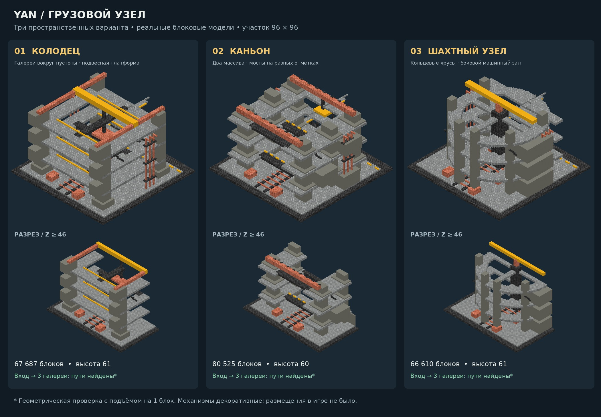

# Freight-node spatial study

Three authored block-model alternatives for choosing an environment direction before Minecraft placement. Each occupies a 96 × 96 plot, reaches 60–61 blocks high and connects the entrance to three principal galleries at elevations 14, 30 and 46. These are spatial prototypes, not a completed general-purpose generator or functioning mod machinery.



| Alternative | Spatial idea | Tradeoff |
| --- | --- | --- |
| Well | Square central void, galleries, overhead gantry and suspended platform | Strong enclosure; repeated decks obscure the interior in exterior views |
| Canyon | Opposing structural masses, staggered bridges, service bays | Clearest long freight axis; less enclosed |
| Shaft | Circular galleries, central core and side machine hall | Strongest distinct silhouette; hall interrupts the ring |

## Reproduce

From the repository root, in its installed Python environment:

```sh
PYTHONPATH=src python examples/sector_study/build.py
python examples/sector_study/present.py
PYTHONPATH=src:examples/sector_study python -m unittest discover -s examples/sector_study -p 'test_*.py'
```

`--no-render` runs geometry, validation, route checks and schematic export only. `--only well|canyon|shaft` selects one design. The presentation script uses DejaVu Sans at the standard Linux font location; change `FONT` on another platform.

Every variant includes executable DSL (`blueprint.py`), a ProjectPlan, merge/connectivity report, Sponge v3 schematic, overview and Z ≥ 46 cutaway. The cutaway removes the front half only for rendering; the schematic contains the whole model. Schematics contain air in their bounding volume and must be placed only in a selected disposable/cleared location after review.

## Reuse and provenance

- Actual existing mcbuild DSL sandbox compiles every design; vanilla block registry checks the palette.
- Actual ProjectPlan validator and transactional merge validate four **authored elevation partitions** and preserve the compiled geometry exactly. These partitions are not semantic LLM worker outputs and do not prove autonomous orchestration.
- Existing textured software camera renderer produces both views directly from the resulting voxels. No generated concept imagery.
- Existing schematic exporter produces the build artifact.
- Custom code is limited to composition, a small geometric reachability check and contact-sheet presentation. No new renderer, exporter, Minecraft bridge or general planner.
- No model API key was available. Composition was authored by the assistant in this session; no external planner/worker LLM call, game placement or live test occurred.

`docs/REUSE_CATALOG.md` remains the source for deferred integrations. Minecraft-agentic repair/critic is a later candidate when a live placement/repair loop is required; Voyager/Mindcraft memory and roles are not needed for this static study. FAWE is not assumed compatible with the NeoForge bridge. No external code was copied.

## Validation and limits

The route check starts at foot coordinate (6, 3, 4), requires solid support and two air blocks, traverses cardinal neighbors and permits one-block ascent/descent with overhead clearance. All used geometry is full cubes. The access stair therefore requires jumping; this is **not a stair-state model, Minecraft pathfinder, accessibility claim or agent traversal test**. Targets are on the main front galleries, beyond the stair exits. The test suite also fills destination cells with stone and requires the checker to reject them.

Checks cover all three targets, palette warnings, plot/height bounds, plan validity and exact merge preservation. They do not establish accessibility of every ledge/service room, structural physics, safe railings, terrain adaptation or working freight machinery. Tracks, crane and machinery are architectural representations. There is no production simulation in this study.

Reported `compile_validate_seconds` covers DSL compilation, plan/merge validation and route checking, not rendering/export/model inference. It is a local measurement, not a performance promise. The two rendered views take materially longer than geometry generation.

## Next decision

Select the spatial direction, then evolve that model: proper stair blocks and railings, more convincing damage/weathering, functional room assignments and fit to an actual site. Preserve the other alternatives as references. Inspect the chosen schematic in a disposable Minecraft location and verify traversal before merging any live-placement behavior. No change to runtime behavior is included here.

## Fly through all three models in creative

Live-preview runner added on this branch. **No NeoForge JAR rebuild or model API key is needed.** It uses the existing `/build` command, `blocks` packets and `inspect_blocks` actions. The reviewed executable blueprints reconstruct exactly the same full-cube models; this is not a fresh design/model run and is not a generic schematic importer.

Keep your current factory checkout intact. In PowerShell:

```powershell
git -C D:\YAN_AGENT_LAB fetch origin yan-sector-previews
git -C D:\YAN_AGENT_LAB worktree add --detach D:\YAN_SECTOR_PREVIEW origin/yan-sector-previews
```

Stop the existing `mcbuild-server-dev` / `mcbuild-server` with Ctrl+C in its own console, so port 8765 is free. Then:

```powershell
powershell -ExecutionPolicy Bypass -File D:\YAN_SECTOR_PREVIEW\examples\sector_study\Start-Preview.ps1
```

Open your **creative test world**, preferably the Overworld. Enable cheats if necessary. Run:

```text
/gamemode creative
/tp @s ~ 180 ~
/build yan-sector-preview
```

The anchor is your position when `/build` is invoked. All three bases are at Y=180, their tops at most Y=240. They start 16 blocks toward +Z, at relative X=-160 (well), -32 (canyon), +96 (shaft). Each is 96 blocks wide, with 32-block gaps. Fly toward +Z; your spawn position is outside the structures. Orientation follows world X/Z, not the direction you are looking.

The server checks **all 214,822 destination cells across all three models before writing any block**. An occupied destination cancels placement; move elsewhere and retry. It never clears terrain or sends air. Empty spaces inside the models and the gaps are not scanned; choose open sky so existing terrain does not intrude into the interior. It does not automatically choose a free site or change player game mode/dimension.

Placement uses packets of at most 1,024 blocks. Each packet is followed by an acknowledged readback of every destination on the existing server thread. This bounds the queue and detects rejected placements without production waits. Actual placement duration depends on game/server/chunk performance; no live timing has been measured yet.

On failure/disconnection the partial model is retained and a JSON report is saved under `runs/sector-preview/`; no destructive automatic rollback. Do not retry at the same occupied position. On success the game says `Three sectors ready`, after all blocks have been read back. Send the JSON report if troubleshooting is needed. This runner currently saves local reports, not automatic GitHub log uploads.

To return to factory work, stop this preview server and restart the usual server from `D:\YAN_AGENT_LAB`. The preview server only accepts the exact `/build yan-sector-preview` request. No changes are made to your normal server or mod.

Offline validation: six tests cover successful placement, a collision in the last site preventing all writes, missing placement detection, wrong-height rejection, incomplete observations and disjoint/bounded real artifacts. Real Minecraft placement remains unverified until the first user run.
